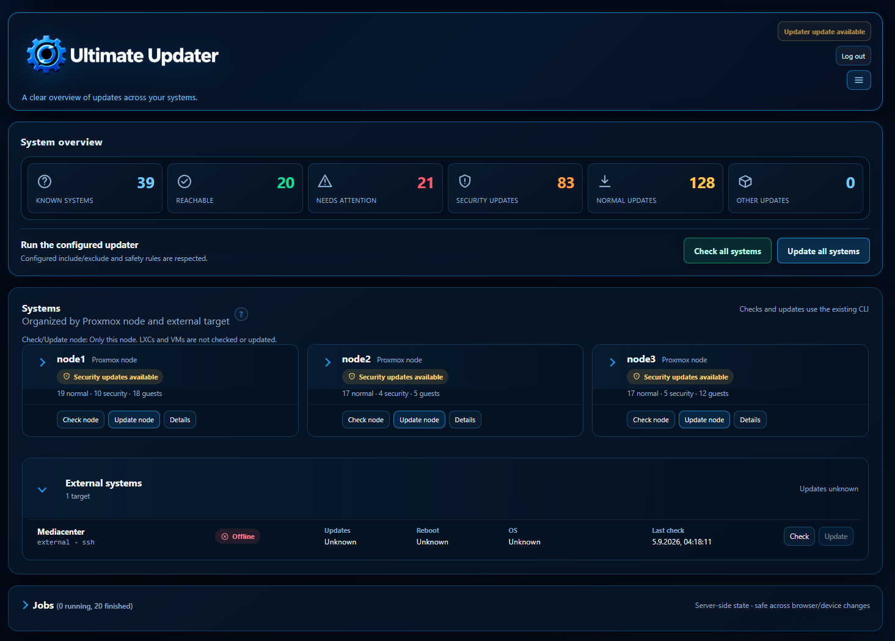

# External systems

[← Back to README](../README.md)

External systems are optional SSH targets in `/etc/ultimate-updater/targets.conf`.
For example:

```ini
[raspi]
host=192.0.2.50
transport=ssh
user=operator
port=22
identity_file=/root/.ssh/ultimate-updater-external
```

Use `ultimate-updater external setup <target>` to prepare a dedicated Ed25519
identity and bootstrap instructions. Passwords are not stored, host-key
checking remains enabled, and the remote helper is root-owned with a
restricted sudoers rule rather than `NOPASSWD: ALL`.

External checks refresh APT package lists before the structured count. The
refresh is metadata-only: it does not install packages or perform lifecycle
actions. A root SSH user runs the refresh directly. A non-root SSH user must
have an existing bootstrap-managed, non-interactive sudo rule for the exact
root-owned, non-symlinked helper action `apt-refresh`:

```text
<target-user> ALL=(root) NOPASSWD: /usr/local/sbin/ultimate-updater-external apt-refresh
```

Run `external-bootstrap.sh` again after upgrading an older installation so
this restricted action is added. The helper performs only
`DEBIAN_FRONTEND=noninteractive apt-get update -y`; it does not grant a
general root shell or a general package-manager bypass. The structured count
then runs without a second refresh. If the non-root user lacks this exact
verified helper path, the check fails closed with
`APT_REFRESH_PRIVILEGE_REQUIRED`; counts and package details remain unknown
and no stale cache value is published. A refresh or count failure likewise
fails closed rather than becoming a zero-update result.
Updates use the fixed remote helper and report reboot requirements without
rebooting automatically. External targets do not receive Proxmox snapshots
or vzdump backups. A recent manual backup verification is required before an
update, unless the owner explicitly uses the one-run risk override.

External systems may have a local `/etc/ultimate-updater/external.conf`.
Its check and update filters are independent from the central inventory:

```text
CHECK:  ONLY_UPDATE_CHECK / EXCLUDE_UPDATE_CHECK
UPDATE: ONLY / EXCLUDE
```

`ONLY` takes precedence over its matching `EXCLUDE`. Central selection is
applied before any remote contact; local settings then apply on the target.
The UI preserves unrelated inventory sections and does not transfer secrets.

The dashboard can expand the External systems section to show the configured
target, transport, status, update information, reboot state, and last check.



Automatic external backup hooks such as restic, borg, PBS workflows, or
custom hooks are not part of the current implementation.

Related: [SSH and VM access](ssh.md), [Configuration](configuration.md),
[Backup and snapshots](backup-and-snapshots.md).
