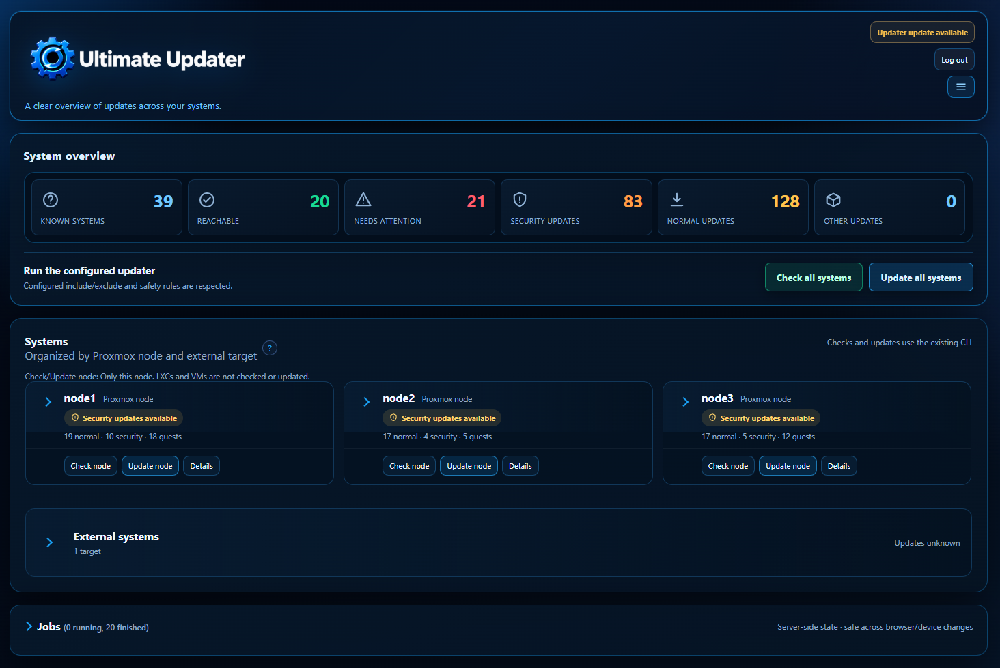
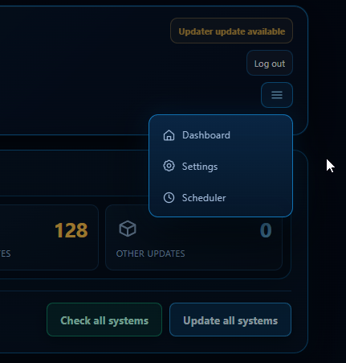
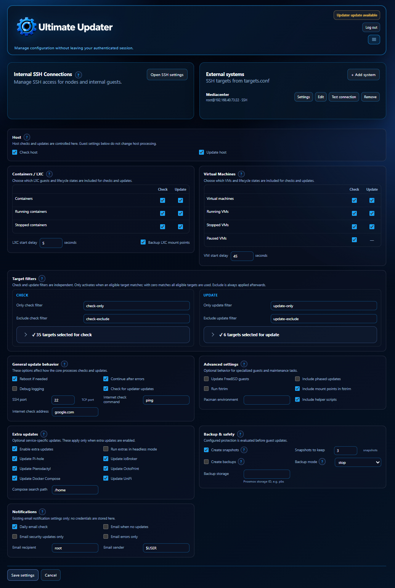
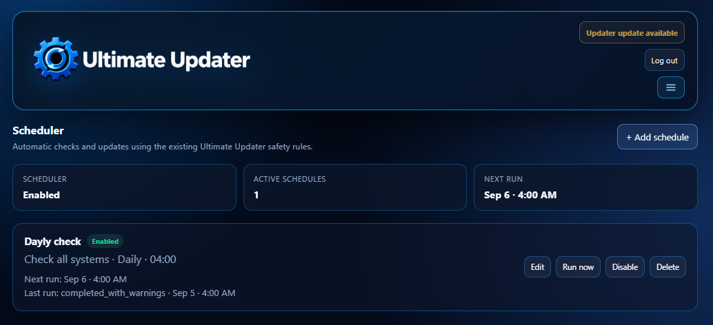

# Web UI

[← Back to README](../README.md)

The Web UI is served by `ultimate-updater-web.service` and listens on port
`8765` by default:

```text
https://<proxmox-node>:8765/
```

It uses the Proxmox-managed certificate when available, accepts TLS 1.2 or
newer, and can use an explicitly configured certificate pair. If automatic
HTTPS has no usable certificate, the documented transition fallback is HTTP;
set `WEB_UI_HTTPS=true` when HTTPS must be required. Use the trusted
management network; this is an action-enabled administrator interface.

## Reverse proxy (explicit opt-in)

Reverse-proxy origin handling is disabled by default. Direct access continues
to compare the browser `Origin` with the request host and the actual Web UI
scheme. For a proxy, configure both settings in the root-owned
`/etc/ultimate-updater/web-ui.conf` and restart the Web UI service:

```text
WEB_UI_PUBLIC_ORIGIN="https://uu.example.invalid"
WEB_UI_TRUSTED_PROXY_CIDRS="127.0.0.1/32"
```

`WEB_UI_PUBLIC_ORIGIN` is the exact public browser origin: HTTPS or HTTP, DNS
name or IP address, and an optional non-default port, without a path or
wildcard. It is authoritative for CSRF, login, WebAuthn, secure-cookie, and
machine-API scheme checks. A configured public origin requires at least one
explicit trusted proxy IP or CIDR in `WEB_UI_TRUSTED_PROXY_CIDRS`; hostnames,
wildcards, empty list entries, duplicate entries, and invalid values are
rejected at startup.

When no public origin is configured, a request from a trusted proxy may use
exactly one `X-Forwarded-Host` and one `X-Forwarded-Proto` header, or one
`Forwarded` header containing an unambiguous `host` and `proto` pair. These
headers are accepted only when the peer address is inside
`WEB_UI_TRUSTED_PROXY_CIDRS`; direct clients cannot enable proxy mode by
adding them. Duplicate, mixed, incomplete, malformed, or conflicting values
are rejected. With `WEB_UI_PUBLIC_ORIGIN` configured, forwarded values are
optional but, when present, must agree with that origin.

The proxy must overwrite forwarded headers rather than pass through client
values. For example, a local Nginx proxy can use:

```nginx
proxy_set_header Host $host;
proxy_set_header X-Forwarded-Host $host;
proxy_set_header X-Forwarded-Proto $scheme;
proxy_pass http://127.0.0.1:8765;
```

An HAProxy frontend can use the equivalent controlled headers:

```haproxy
http-request set-header X-Forwarded-Host %[req.hdr(host)]
http-request set-header X-Forwarded-Proto https if { ssl_fc }
http-request set-header X-Forwarded-Proto http unless { ssl_fc }
server ultimate-updater 127.0.0.1:8765 check
```

The same contract applies to Caddy, Traefik, Nginx Proxy Manager, and other
proxies: restrict backend access to the proxy, overwrite the forwarded
headers, and configure the proxy's source address or network explicitly.
Forwarded headers are never trusted from arbitrary public client requests.
CSRF tokens, sessions, authentication, and WebAuthn validation remain
required; proxy configuration is not a security bypass.

### Trusted reverse-proxy authentication (explicit opt-in)

Issue #359 and PR #363 by X1pheR proposed a trusted forward-auth mode. The
Ultimate Updater implementation is adapted to the current develop session,
CSRF, Origin, TFA, and safety boundaries. It is disabled by default and does
not replace Proxmox, PAM, or internal login. It is a local operator allowlist,
not an OIDC provider or a release/provenance mechanism.

Enable it only when the Web UI backend is reachable exclusively through the
configured proxy source networks. The existing `WEB_UI_TRUSTED_PROXY_CIDRS`
setting is the source allowlist, and the following additional settings are
required in `/etc/ultimate-updater/web-ui.conf`:

```text
WEB_UI_TRUSTED_AUTH_ENABLED="true"
WEB_UI_TRUSTED_AUTH_IDENTITY_HEADER="Remote-User"
WEB_UI_TRUSTED_AUTH_IDENTITIES="uu-operator@example.invalid"
WEB_UI_TRUSTED_AUTH_ASSERTION_FILE="/etc/ultimate-updater/gateway-assertion"
```

The identity header is accepted only once, must match the configured exact
allowlist, and is evaluated only when the actual TCP peer is inside
`WEB_UI_TRUSTED_PROXY_CIDRS`. `X-Forwarded-For` and every other forwarded
client-address header are ignored for trust decisions. A CIDR alone is never
enough: every request also needs exactly one fixed
`X-UU-Gateway-Assertion` header whose value matches the assertion file.

The assertion file must be an absolute regular non-symlink file owned by the
Web UI service user with mode `0600`. It must contain one ASCII assertion of at
least 43 characters and sufficient character diversity. Generate and install
it out of band; never put the value in Git, a command line, status data, API
responses, logs, or this Web UI. Invalid, missing, duplicated, or insecure
proof fails closed. The comparison is constant-time and the file metadata and
contents are revalidated on every request.

Successful gateway authentication creates the same short-lived,
CSRF-protected Web UI session used by the native UI, and that session is bound
to the currently revalidated allowlisted proxy identity. Identity changes,
logout, expiry, missing proof, direct backend access, and malformed headers do
not reuse the session. Native login recovery remains available, while the
disabled default path is unchanged. No Web UI form exposes or edits the
gateway assertion.

The proxy must strip caller-supplied identity/assertion headers and inject its
own values over a protected connection. Shared-NAT deployments must not
enable this mode unless the backend can independently distinguish the trusted
proxy. This feature adds no guest, Proxmox, package, update, snapshot,
lifecycle, or deployment action.

## Main areas

- **Dashboard:** nodes, LXC/VM guests, external targets, reachability, update
  state, reboot indicators, and warnings.
- **Target details:** OS, transport, normal/security or total-only update
  information, last check, and errors.
- **Jobs and logs:** persistent server-side job state and retained output.
- **Settings:** typed controls for checks, filters, lifecycle, snapshots,
  backups, notifications, and DEBUG.
- **Internal SSH Connections:** resolved sources and explicit overrides for
  nodes and VMs.
- **Version information:** installed version, branch, commit, exact tag when
  available, and available version.

### Dashboard

The dashboard combines the system overview, node and guest status, external
targets, and server-side jobs in one view.



### Target selection

The Systems view can optionally manage target selection directly. Enable
**Use Ultimate Updater target selection** in Settings to show independent
**Check** and **Update** controls for Nodes, LXC containers, VMs, and External
systems. Each control cycles through **No explicit selection**, **Only**, and
**Exclude**. The first use asks for confirmation because enabling this mode
ignores existing Proxmox Only/Exclude tags; those tags are not changed or
removed. Disabling the mode keeps the saved rules and restores legacy tag
selection.

### Navigation

Use the compact menu button in the header to open the current navigation. It
contains Dashboard, Jobs, Settings, and Scheduler. Jobs is always available,
including when there are no active or recent jobs.



### Settings

Settings are grouped into connection management, target selection, update
behavior, backup and safety, extra updates, and notifications.



### Jobs and logs

Jobs run server-side and remain available after the browser session ends. The
Jobs view shows the action, target, start time, result, exit code, and a link
to the retained log.

For a running non-interactive job or Check, choose **Live output**. This is a
read-only terminal view: output is streamed while the job runs, and closing
the browser does not stop the server-side job. The complete log remains
available afterwards for viewing or download.

Interactive update jobs can be opened with **Live terminal** when their
transport supports interaction. This is a real terminal view with PTY output,
ANSI/cursor handling, input, and terminal resizing. A browser disconnect does
not end the job; the terminal can be attached again and existing output may be
replayed. After completion the terminal remains open and shows **Job finished**
or **Job failed**. In either case, existing output remains visible and the
complete log can still be viewed or downloaded. Failed jobs disable further
input, while Close remains available.

On small displays the terminal uses a responsive, fullscreen-like layout. The
mobile keybar provides **Esc**, **Tab**, arrow keys, and **Enter**. **Terminal
Font Size** can be adjusted with the font controls and is saved per browser.


### Scheduler

The Scheduler uses the existing job runner and safety rules. It supports
enabled schedules, selected weekdays, next and last run information, and the
actions Edit, Run now, Disable, and Delete.



The UI does not expose a general shell, arbitrary commands, private keys, or
password storage. Configuration writes preserve unrelated settings and are
validated atomically. Updates require browser confirmation.

### Reboot now

In a target's detail view, **Reboot now** is shown only when **Reboot required**
is **Yes** and the target is a supported Node, LXC, or VM. It is not a general
reboot button in the overview. Guest reboots require one confirmation; Node
reboots require an additional safety confirmation because running guests may be
affected. Running or conflicting jobs, offline targets, and unsupported or
restricted targets block the action.

This manual action is separate from `REBOOT_IF_NEEDED`: that setting controls
reboot handling in the Update path, while **Reboot now** is an explicit action
started from target details.

## Authentication and service control

The Web UI uses Proxmox authentication by default. The login domain list is
read from Proxmox, credentials are checked by its local API, and access is
granted only when the account has the full built-in `Administrator` effective
privileges at `/`. The service is root-owned because the existing CLI and job
runner need local permissions. Useful service commands are:

```bash
systemctl status ultimate-updater-web
systemctl restart ultimate-updater-web
journalctl -u ultimate-updater-web
```

The normal login does not require a separate Ultimate Updater user. For
example, an existing `alice@pam` or `admin@pve` Proxmox administrator can use
the corresponding domain and their existing password. Proxmox remains
authoritative for authentication, account status, realms, and authorization;
Ultimate Updater does not create or modify Proxmox users, groups, roles, or
ACLs.

The existing `UU_AUTH_BACKEND=internal` mode remains available as an explicit
fallback/development backend. The earlier `UU_AUTH_BACKEND=pam` plus
`WEB_UI_PAM_USER=admin` mode remains a legacy compatibility path; it is not the
default and does not provide Proxmox realm or RBAC authorization.

```text
UU_AUTH_BACKEND=pam
WEB_UI_PAM_USER=admin
```

Proxmox two-factor authentication uses a short-lived two-step login flow.
TOTP, single-use recovery keys, realm-enforced YubiKey OTP, and WebAuthn are
supported; the factor response is sent back to Proxmox with the signed
challenge before the Ultimate Updater session is created. A partial Proxmox
ticket is never treated as a successful login. Passwords, OTPs, recovery
keys, WebAuthn assertions, and Proxmox tickets are not stored persistently.

WebAuthn requires a trusted HTTPS origin and a matching Proxmox WebAuthn RP-ID
configuration. Configure Proxmox with the shared RP-ID and, when using
multiple ports, leave its `origin` dynamic so Proxmox derives the expected
origin from each validated request host. The browser origin and the Ultimate
Updater host must match exactly; do not use an IP address when the RP-ID and
certificate use a hostname. A browser secure context is required, and the
Proxmox GUI on port 8006 and Ultimate Updater on port 8765 must use the same
RP-ID. Do not disable Proxmox TFA or browser certificate validation as a
workaround.

The interface is responsive on narrow displays. The dashboard can also show
an expanded external-system section when target details are needed.


The optional login welcome screen is separate from the Web UI. It can show
cached update information at login and uses the local check configuration;
the cache is refreshed by the regular update check. It does not wait for a
live GitHub version request during login.

Related: [Configuration](configuration.md), [SSH and VM access](ssh.md),
[Troubleshooting](troubleshooting.md).
